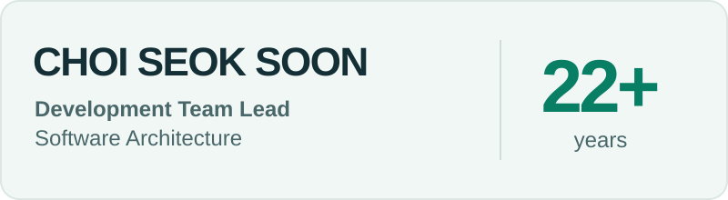

<picture>
  <source media="(max-width: 600px) and (prefers-color-scheme: dark)" srcset="assets/profile-dark-mobile-22plus.svg">
  <source media="(max-width: 600px)" srcset="assets/profile-light-mobile-22plus.svg">
  <source media="(prefers-color-scheme: dark)" srcset="assets/profile-dark-22plus.svg">
  
</picture>

# 최석순 · mant81

**개발 팀장 · Development Team Lead** 
**개발경력 22년+** · 팀을 이끌고, 시스템을 설계하고 구현합니다.

민간·공공 SI·SM 및 클라우드 프로젝트에서 
**개발팀을 이끌며 아키텍처 설계와 개발 표준화를 함께 수행**해 왔습니다. 
팀의 기술 의사결정을 이끌고, 직접 구현에 참여해 개발부터 운영까지 이어지는 문제를 해결합니다.

[Focus](#focus) · [Service](#in-development) · [Tech stack](#tech-stack) · [Credentials](#credentials) · [Connect](#connect)

---

## Focus

- **개발팀 리딩** — 개발 업무 조율, 공통 프레임워크·개발 기준 정립, 팀의 기술 이슈 해결 지원
- **아키텍처·서비스 현대화** — Java/Spring 기반 시스템, React + Spring Boot 전환, Gateway·JWT 적용
- **클라우드 플랫폼** — CMP 구축 및 Private/Public Cloud 연계
- **CTI·음성 AI** — WebSocket 기반 상담 시스템, STT 연동, LLM 기반 내부 상담 녹취 요약 서비스 연계

## In development

### [AASTUDIO ↗](https://aastudio.kr)

**Architecture · AI · Smart Factory**를 연결하는 서비스와 도구를 만들고 있습니다.

- **설계 도구** — 다이어그램·DB 모델링 웹 도구와 AA Studio Free 출시 준비
- **AI 서비스** — 반복 업무를 돕는 AI 서비스와 솔루션 개발
- **스마트팩토리** — QMS를 비롯한 제조·품질 관리 솔루션 준비

## Tech stack

**Backend & Architecture** 
Java · Spring Boot · Spring · Spring Batch · Spring Cloud Gateway · MyBatis · Node.js 
MSA · REST API

**Frontend & UI** 
React · Vue / Nuxt · Next.js · JavaScript · TypeScript · jQuery · HTML5 · CSS3 
Bootstrap · Chakra UI · Ant Design · Nexacro

**Cloud & Delivery** 
CMP · OpenStack · VMware · OpenShift · Docker · Jenkins · Bamboo · Bitbucket · PM2 
Private / Public Cloud · CI/CD

**AI & Communication** 
CTI · STT · LLM / ChatGPT · WebSocket · RAG · AI Evaluation (Harness) 
RED5 · Wowza · Web·Mobile 연계

**Data & Search** 
Oracle · Tibero · MS SQL Server · MySQL · MariaDB · PostgreSQL · MongoDB 
Lucene · Infinispan

**Enterprise** 
JSP / Servlet · eGovFrame · BXM · Nexcore · Struts · iBatis · Velocity · ASP · C#

**Middleware** 
WebLogic · JEUS · Tomcat · JBoss · WildFly · Nginx

**Security** 
JWT · PKI/GPKI

## Credentials

**정보보안산업기사** · **정보처리기사** · **정보처리산업기사**

사무자동화산업기사 · 전자상거래관리사 2급 · 전자상거래운용사 외 다수 자격을 보유하고 있습니다.

<b>학력 · 추가 자격 · 기술자 등록</b>

**Education**

- ***대학교 컴퓨터정보통신학과 학사
- ***대학교 전자상거래과 전문학사
- ***고등학교 졸업

**Additional qualifications**

- EC기술관리사 2급 · 인터넷정보검색사 2급 · 정보처리기능사 · 워드프로세서 2·3급
- TITQ · 자동차정비기능사 · 자동차검사기능사 · 굴삭기운전기능사 · 지게차운전기능사 · 제한무선통신사
- 소프트웨어기술자(KOSA) · 정보통신기술자(KICA)

### Continuous learning

개발 경험에 AI·클라우드·보안 지식을 더하고 있습니다.

| Year | Learning |
| :--- | :--- |
| **2026** | 생성형 AI와 개인정보 보호법 · AI 개발·활용 단계별 고려사항 · AI 투명성·취약점 및 규제 · 개인정보 영향평가 |
| **2025** | ISMS-P 제도 및 구축·운영 · 개인정보 처리자 기본·실무 · AI 자동화된 결정 · 산업보안 실무 |
| **2024** | 클라우드 가상화 · IaaS 인프라 개발 · 클라우드 네이티브 기본 기술 · ISMS-P |
| **2017 — 2023** | 개인정보보호 전문교육 · SW 개발보안 기본·심화 · 침해사고 대응 훈련 |

## Connect

기술과 경험을 기록하고 공유합니다.

**Email** [mant@nate.com](mailto:mant@nate.com) · [mant81@gmail.com](mailto:mant81@gmail.com) 
**Writing** [Tistory](https://mant81.tistory.com) · [프로필과 기록](https://mant81.tistory.com/category/%ED%94%84%EB%A1%9C%ED%95%84) · [Naver Blog](https://blog.naver.com/mantkr) 
**Code** [github.com/mant81](https://github.com/mant81)

<b>GitHub activity</b>

  
  

[기여 내역과 저장소 직접 보기 →](https://github.com/mant81?tab=repositories)

---

Profile updated with career & learning information as of 2026.10.
